<div align="center">



<br/>

[](https://netrix.pw)
[](https://t.me/netrixpw)
[](https://t.me/netrixpwsupport)
[](https://t.me/Kav16Dev)

</div>

<br/>

```ts
// kavik.ts

const kavik = {
  name: "Kavik",
  role: "Основатель и разработчик Netrix.pw",

  building: [
    "хостинг игровых серверов, VDS и VPN",
    "личный кабинет, оплата и автопродление",
    "расширения для панели Pterodactyl",
  ],

  stack: {
    языки: ["TypeScript", "JavaScript", "SQL", "Bash"],
    веб: ["Next.js", "React", "Tailwind CSS", "Node.js"],
    данные: ["Prisma", "MySQL"],
    инфраструктура: ["Docker", "Nginx", "Linux", "Pterodactyl"],
  },

  currentlyThinking: () => "как сделать ещё быстрее и проще",
} as const;

export default kavik;
```

<br/>

```ts
// контакты

export const contacts = {
  сайт: "https://netrix.pw",
  новости: "https://t.me/netrixpw",
  поддержка: "https://t.me/netrixpwsupport",
  личная_жизнь: "https://t.me/Kav16Dev", // личный канал
};
```

<div align="center">

<sub>Код сайта в закрытом репозитории · приветствие написано кодом</sub>

</div>
